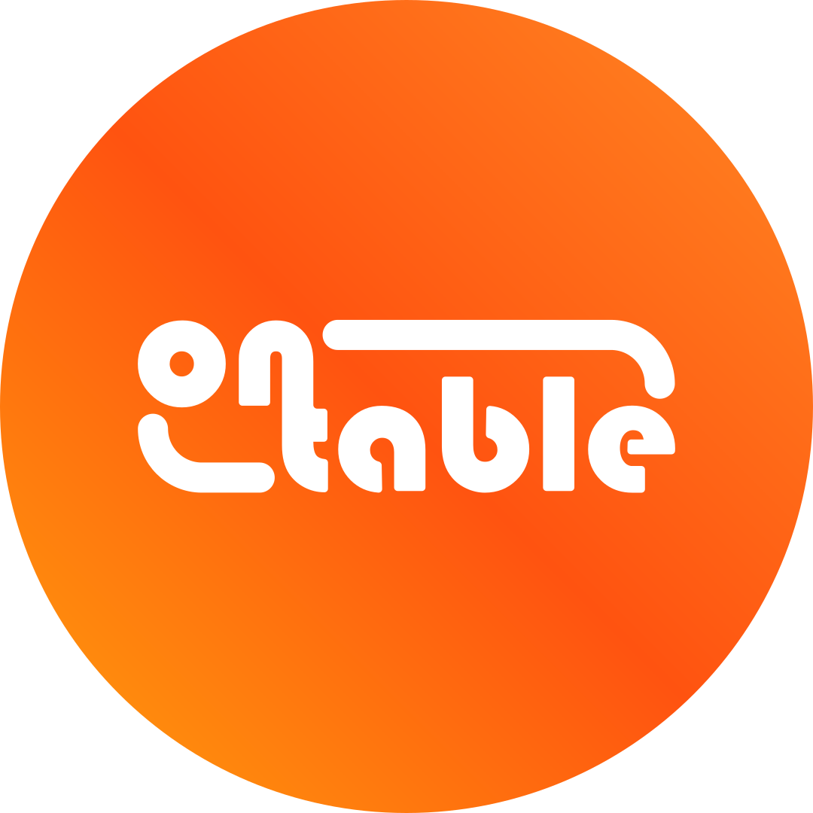

# INVOICE

**OnTable Studio** · From our table to yours.
ontablestudio@gmail.com

---

|                       |                             |
| --------------------- | --------------------------- |
| **No. Invoice**       | INV/ONT/2026/10/001         |
| **Tanggal penagihan** | 31 Oktober 2026             |
| **Berlaku sampai**    | 6 November 2026             |
| **Proyek**            | Colgate 95% Vitamin C Blast |

## Ditagihkan kepada

**PT Scarlet Kreasi Indonesia**
U.p. Frezi Andika
Jl. Cirendeu Indah III No.14, Cireundeu, Kec. Ciputat Timur, Kota Tangerang Selatan, Banten 15419
Telp. 0812-6129-7358

## Deskripsi Proyek

Pembuatan game booth 95% Vitamin C Blast untuk kampanye Colgate Optic White Vitamin C (event 28 Oktober - 1 November 2026).

## Rincian

|  No | Deskripsi                                                                                                                                                                                | Jumlah  | Harga Satuan |        Total |
| --: | ---------------------------------------------------------------------------------------------------------------------------------------------------------------------------------------- | ------- | -----------: | -----------: |
|   1 | **Pengembangan game 95% Vitamin C Blast** Link game: https://colgate-omega.vercel.app Pembuatan game booth layar sentuh untuk TV 43 inci: pemain menembak (tap) molekul Vitamin C. | 1 paket | Rp 4.000.000 | Rp 4.000.000 |

|                          |                  |
| ------------------------ | ---------------: |
| Subtotal                 |     Rp 4.000.000 |
| Pajak (PPh 21)           |       Rp 102.564 |
| **HARGA TERMASUK PAJAK** | **Rp 4.102.564** |

**Terbilang:** _Empat juta seratus dua ribu lima ratus enam puluh empat rupiah_

## Informasi Pembayaran

|                  |                         |
| ---------------- | ----------------------- |
| **Bank**         | Bank Central Asia (BCA) |
| **Atas Nama**    | Ahmad Fachrozi Suhand   |
| **No. Rekening** | `5865405356`            |
| **Konfirmasi**   | `081382711025`          |

## Syarat dan Ketentuan

1. Pembayaran dilakukan secara penuh melalui transfer ke rekening di atas.
2. Cantumkan nomor invoice pada berita transfer dan kirim bukti transfer ke nomor konfirmasi.
3. PPh 21 dipotong Klien dan disetor ke negara; bukti potong diserahkan kepada OnTable Studio.
4. Biaya transfer dan biaya bank ditanggung pembayar, sehingga Penerbit menerima nominal penuh.
5. Pembayaran yang telah diterima tidak dapat dikembalikan, kecuali disepakati tertulis.
6. Hak pakai hasil pekerjaan beralih kepada Klien setelah lunas, kecuali ditentukan lain dalam perjanjian.

## Pengesahan

Hormat kami,
**OnTable Studio**

   

**Ahmad Fachrozi Suhand**
Lead OnTable Studio

---

_Terima kasih atas kepercayaan Anda kepada OnTable Studio._
