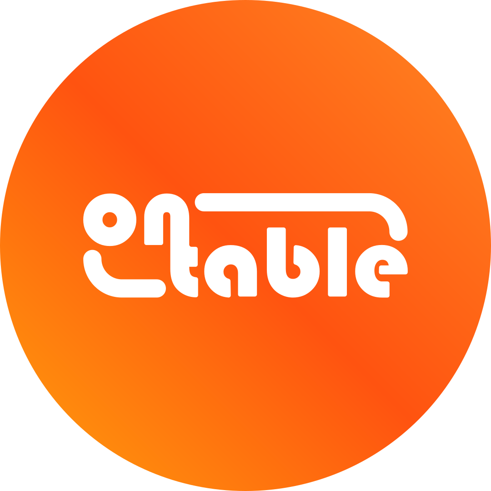

# INVOICE

**OnTable Studio** · From our table to yours.
ontablestudio@gmail.com

---

|                       |                                             |
| --------------------- | ------------------------------------------- |
| **No. Invoice**       | INV/ONT/2026/10/001                         |
| **Tanggal penagihan** | 28 Oktober 2026                             |
| **Berlaku sampai**    | 2 November 2026                             |
| **Proyek**            | [Nama proyek / referensi PO atau penawaran] |

## Ditagihkan kepada

**[Nama Klien / Perusahaan]**
U.p. [Nama Penanggung Jawab]
[Alamat lengkap klien]
[Email / No. telepon klien]
NPWP: [NPWP klien, jika ada]

## Deskripsi Proyek

[Deskripsi singkat proyek, layanan, atau barang]

## Rincian

|  No | Deskripsi                                                            | Jumlah  | Harga Satuan | Total |
| --: | -------------------------------------------------------------------- | ------- | -----------: | ----: |
|   1 | **[Deskripsi layanan / pekerjaan]** [Rincian lingkup, jika perlu] | 1 paket |         Rp 0 |  Rp 0 |

|                   |          |
| ----------------- | -------: |
| Subtotal          |     Rp 0 |
| **TOTAL TAGIHAN** | **Rp 0** |

**Terbilang:** _Nol rupiah_

## Informasi Pembayaran

|                  |                         |
| ---------------- | ----------------------- |
| **Bank**         | Bank Central Asia (BCA) |
| **Atas Nama**    | Ahmad Fachrozi Suhand   |
| **No. Rekening** | `5865405356`            |
| **Konfirmasi**   | `081382711025`          |

## Syarat dan Ketentuan

1. Pembayaran dilakukan secara penuh melalui transfer ke rekening di atas.
2. Cantumkan nomor invoice pada berita transfer dan kirim bukti transfer ke nomor konfirmasi.
3. Biaya transfer dan biaya bank ditanggung pembayar, sehingga Penerbit menerima nominal penuh.
4. Pembayaran yang telah diterima tidak dapat dikembalikan, kecuali disepakati tertulis.
5. Hak pakai hasil pekerjaan beralih kepada Klien setelah lunas, kecuali ditentukan lain dalam perjanjian.

## Pengesahan

Hormat kami,
**OnTable Studio**

   

**Ahmad Fachrozi Suhand**
Lead OnTable Studio

---

_Terima kasih atas kepercayaan Anda kepada OnTable Studio._
